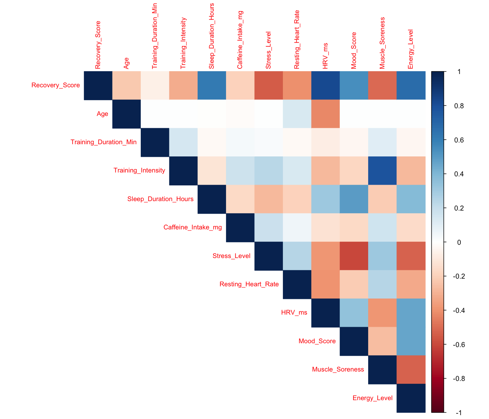
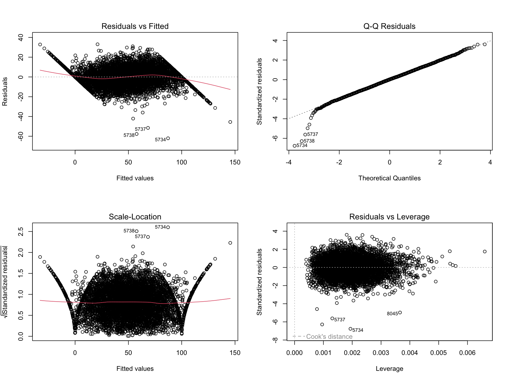
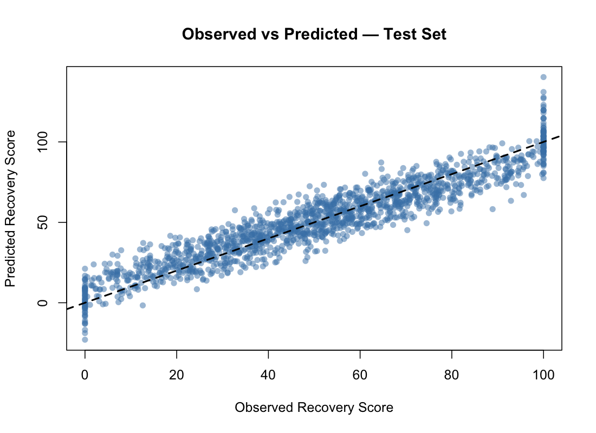
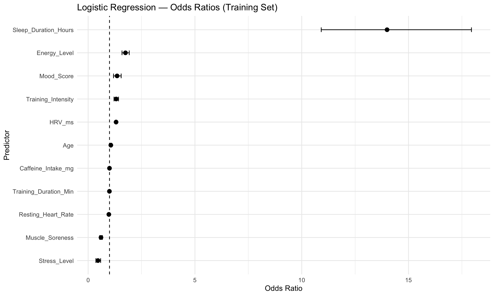
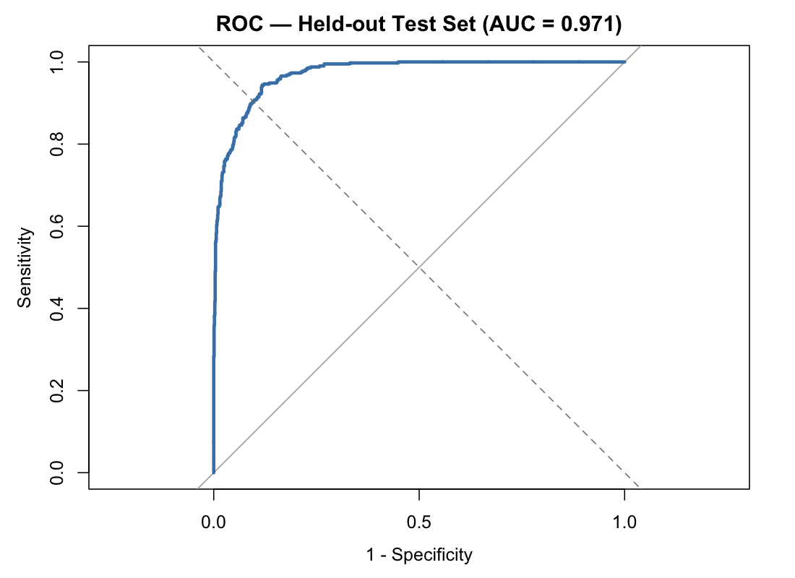

# Athlete Recovery — Statistical Analysis in R

Statistical modeling project investigating how training, sleep, stress, and physiological factors relate to athlete recovery using a **synthetic dataset**.

## Methods

- Exploratory data analysis and correlation analysis
- Multiple linear regression, residual diagnostics, VIF, and Box–Cox transformation
- Variable selection using AIC and BIC
- Logistic regression to classify high recovery (`Recovery_Score >= 70`)
- Predictive evaluation on an 80/20 training/test split

## Test-set results

| Metric | Value |
|---|---:|
| Linear regression R² | 0.8875 |
| RMSE | 9.0966 |
| MAE | 7.2774 |
| Logistic regression accuracy | 91.32% |
| Logistic regression ROC-AUC | 0.9714 |

These results describe performance on synthetic data and should not be interpreted as validated performance on real athletes.

## Visualizations

**Correlation matrix**

**Linear regression diagnostics**

**Observed vs. predicted recovery score**

**Logistic regression odds ratios**

**ROC curve — test set**

## Files and usage

- `progetto_athlete_recovery_completo.R` — analysis code
- `athlete_recovery_synthetic.csv` — synthetic dataset
- `model_metrics.csv` — test-set evaluation metrics
- `Figures/` — exported plots

Open the R script in RStudio, set the working directory to the repository root, install the required R packages, and run the script.

**Tools:** R, RStudio, statistical modeling and visualization packages.
